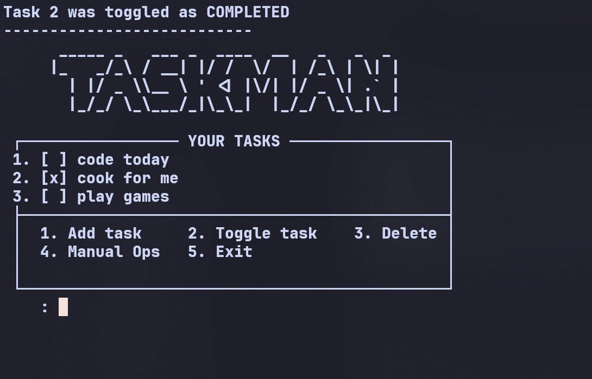

# Taskman

A terminal-based task manager written in C, built from scratch.
This is my first repo where I actually learned a lot.

## Current Features

- Supports CRUD 
- Toggle task to completed
- Dynamic task memory allocation
- Multiple source and header files
- CMake-based build system
- Logs tasks in a file to be accessed afterwards

## Preview



## Project Structure

```text
.
|-- CMakeLists.txt
|-- LICENSE
|-- README.md
|-- include
|   |-- filelog.h
|   |-- input.h
|   |-- task.h
|   `-- taskman.h
`-- src
    |-- filelog.c
    |-- input.c
    |-- main.c
    |-- task.c
    `-- taskman.c
```

## Building

Taskman currently uses CMake with Clang.

Configure(from the project's root directory):

```bash
cmake -S . -B build
```

Build:

```bash
cmake --build build
```

Run:

```bash
./build/taskman
```
